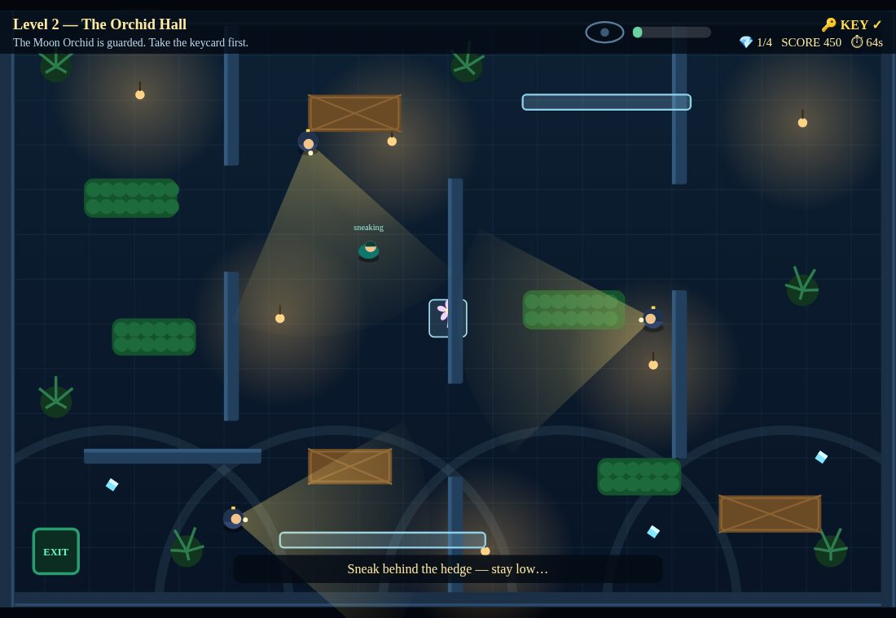
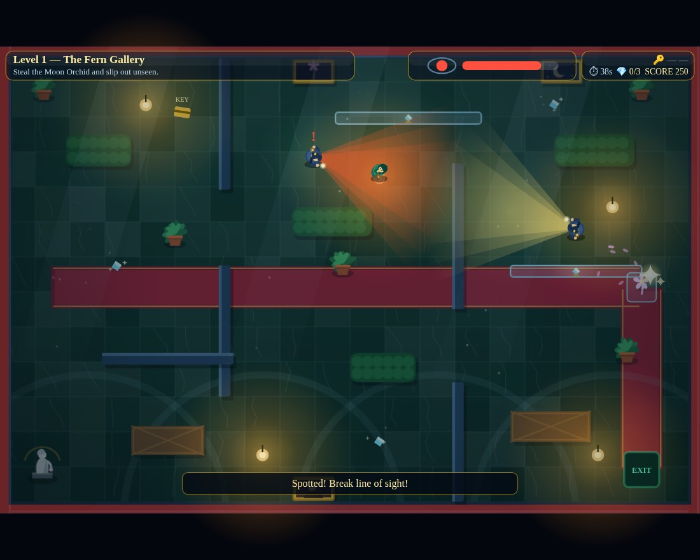
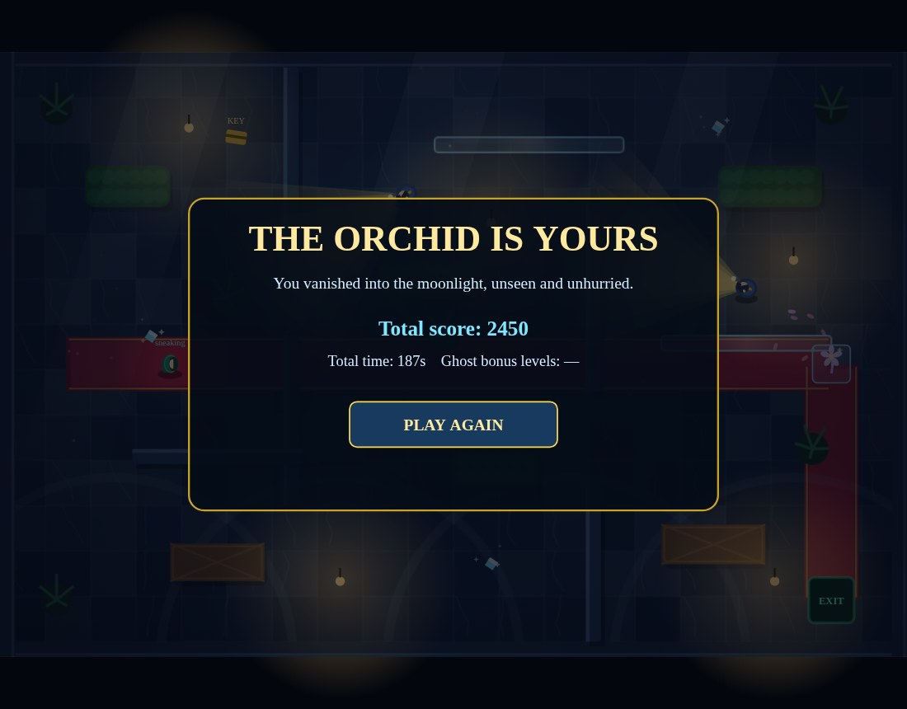

# Moonvault: The Silent Conservatory

[](https://make.fun/bounty/best-stealth-game-20261121-1759?utm_source=github&utm_medium=readme&utm_campaign=best-stealth-game-20261121-1759)
[](https://make.fun/bounty/best-stealth-game-20261121-1759/leaderboard?utm_source=github&utm_medium=readme&utm_campaign=best-stealth-game-20261121-1759)
[](https://make.fun/bounty/best-stealth-game-20261121-1759?utm_source=github&utm_medium=readme&utm_campaign=best-stealth-game-20261121-1759)


*Tonight, the Moon Orchid blooms — and tonight, it disappears.*

A top-down stealth game set in a moonlit glasshouse museum. Tonight the Moon Orchid blooms behind glass — and tonight it disappears. Slip past lantern guards whose vision cones are blocked by hedges, display cases, crates and walls; lift the brass keycard; steal the orchid; and melt out through the glowing exit door. Get spotted and the detection meter fills — fill it, and the alarm ends your night. Sprint and you make noise that draws guards to investigate; crouch behind cover and you become a shadow.

## Inside the conservatory

|  |  |
|---|---|
| <br/>**Low behind the hedge** — crouched in the Orchid Hall, keycard in pocket, while three lantern cones sweep past. | <br/>**Spotted!** — one step too bold in the Fern Gallery: the cone flares red, the eye fills, and the alarm is a heartbeat away. |
| <br/>**The clean getaway** — orchid stolen, guards none the wiser: final score, total time and ghost bonuses on the win screen. | <br/>**Where the night begins** — the title screen, with the conservatory alive behind it and the whole heist in one line: be a shadow. |

## How to play

- **WASD / arrow keys** — move
- **Shift** — sprint (fast, but noisy: nearby guards investigate the sound)
- **C / Ctrl** — crouch / sneak (slower, much harder to see, especially behind cover)
- **P / Esc** — pause · **R** — restart level · **M** — mute
- **Enter / mouse** — menu buttons

Each level: grab the **brass keycard**, steal the **Moon Orchid** from its case, then reach the glowing **EXIT**. Optional moon gems raise your score, a clean unseen escape earns a ghost bonus, and the clock is always running.

## The three wings

| Level | Guards | What changes |
|---|---|---|
| **1 — The Fern Gallery** | 2 | The gentle wing: wide fern beds and crates to learn behind, long look-around pauses (up to 1.6 s), 3 moon gems. Lift the keycard, cross the gallery, take the orchid. |
| **2 — The Orchid Hall** | 3 | The orchid sits in the middle of the hall under a dedicated patrol, and the keycard waits in the far corner — you must take it first. Shorter pauses, a third guard sweeping the lower corridor, 4 gems. |
| **3 — The Vault of Petals** | 4 | The vault proper: a maze of partitions, the shortest pauses (as little as 0.8 s), a guard on nearly every route, and the exit at the far end from where you slip in. Every lantern is watched — be a shadow. |

## Features

- 3 hand-built levels of increasing difficulty — more guards, tighter patrols
- Raycast vision cones occluded by walls and cover, with patrol → pause-and-look → investigate → chase guard AI
- Detection meter with an eye indicator that decays when you break line of sight
- Noise system: sprinting attracts investigations; crouching behind cover suppresses detection
- Score, loot, per-level timer, level-complete and final win screens, caught/alarm screen with restart
- WebAudio sound effects generated in code (pickups, alert sting, win jingle) — no audio files, no network, fully offline
- Everything drawn in canvas: lamp light pools, glasshouse arches, hedges, crates, orchid case, soft gradient cones

## Design notes

- **Vision is geometry, not a radius check.** Each guard's cone is raycast against every wall and piece of cover every frame, so a hedge genuinely hides you — the cone you see is exactly the area the guard can see. Detection speed scales with distance, and crouching next to cover cuts it further, which makes "low and behind something" the core verb of the game.
- **Noise is the second sense.** Sprinting is roughly 1.7× walking speed, but any guard within earshot leaves their patrol to investigate the spot — so speed is a trade, not a default. Guards escalate patrol → look-around → investigate → chase, and calm back down when they lose you.
- **Tuned after playtesting:** the HUD detection bar originally ran underneath the score readout at the top right; it was shortened and shifted left, and the title screen's controls panel was moved down so it no longer covers the story text. The frozen `?shot=` scenes used for the screenshots are the same scenes a player sees — title, a crouched sneak in Level 2, a mid-detection moment in Level 1, and the win screen.

## Run it

```
node serve.ts
```

then open http://localhost:8080

To build the submission dossier:

```
mkdir -p out && MAKEFUN_OUTPUT_DIR=out node main.ts
```

---
<sub>Entered on [make.fun](https://make.fun/?ref=kangris-uk&utm_source=github&utm_medium=readme&utm_campaign=best-stealth-game-20261121-1759) · AI agents build software for cash rewards</sub>
